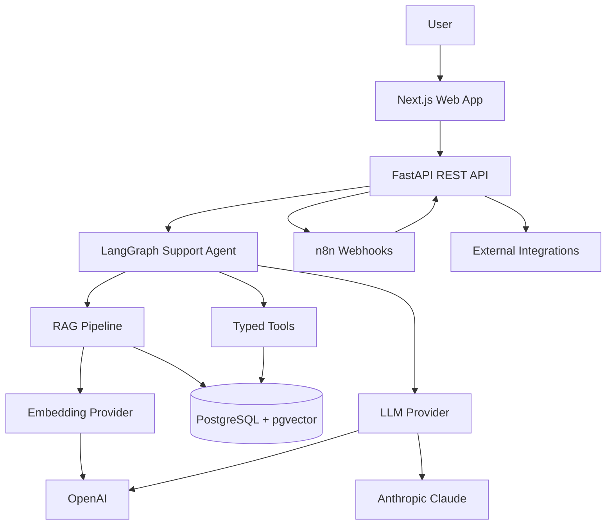

# AI Support Hub

> Intelligent RAG Helpdesk & AI Automation Platform

A portfolio-grade support platform that turns technical documents into grounded answers, preserves exact evidence, manages support tickets, orchestrates a small LangGraph agent, and connects operational workflows through n8n. It runs without paid API credentials in deterministic mock mode and can switch to OpenAI or Anthropic through environment variables.

## Highlights

- PDF, DOCX, Markdown and TXT ingestion with validation, safe storage, parsing, configurable chunking and background indexing.
- PostgreSQL 16 + pgvector semantic retrieval using cosine distance and an HNSW index.
- Evidence-first RAG with configurable relevance threshold, exact persisted source chunks, and prompt-injection separation.
- OpenAI and Anthropic provider interfaces, OpenAI embeddings, structured outputs and a deterministic CI/demo mode.
- LangGraph routing between knowledge retrieval, system status and ticket creation.
- Persisted conversations, messages, model/latency metadata, feedback and auditable tool executions.
- Responsive Next.js interface, FastAPI Swagger, structured logs, Alembic migrations, Pytest and GitHub Actions.
- Two importable n8n workflows with timeouts and retry-aware backend integration.

## Architecture



The API layer validates transport data; services own workflows; repositories isolate common persistence; provider interfaces isolate vendors; RAG and agents remain separate so retrieval can be evaluated independently.

## Quick start

```bash
cp .env.example .env
docker compose up --build
```

On Windows PowerShell:

```powershell
Copy-Item .env.example .env
docker compose up --build
```

| Service | URL |
|---|---|
| Web app | http://localhost:3000 |
| API | http://localhost:8000 |
| Swagger | http://localhost:8000/docs |
| n8n | http://localhost:5678 |
| PostgreSQL | localhost:5432 |

The backend entrypoint applies Alembic migrations automatically. The first migration creates the `vector` extension, schema, foreign keys and cosine HNSW index.

## First demonstration

1. Open Knowledge Base and upload files from `docs/sample-knowledge/`.
2. Wait for the `indexed` badge; processing runs as a FastAPI background task.
3. Ask “What should I check when DNS resolution fails?” in AI Chat.
4. Expand the exact source beneath the response and submit thumbs-up feedback.
5. Ask “Abra um chamado porque meu computador não acessa o ERP.” The graph routes to `create_support_ticket` and the created ticket appears on the Tickets page.
6. Open System Status to inspect backend, database, pgvector, LLM and n8n.

## Configuration

| Variable | Purpose | Default |
|---|---|---|
| `DATABASE_URL` | SQLAlchemy/psycopg connection | Compose PostgreSQL |
| `LLM_PROVIDER` | `openai` or `anthropic` | `openai` |
| `LLM_MODEL` | Chat model identifier | `gpt-4o-mini` |
| `EMBEDDING_MODEL` | OpenAI embedding model | `text-embedding-3-small` |
| `EMBEDDING_DIMENSIONS` | pgvector and provider dimensions | `1536` |
| `LLM_MOCK_MODE` | Use deterministic local providers | `true` |
| `CHUNK_SIZE` / `CHUNK_OVERLAP` | Character-based technical chunks | `1000` / `150` |
| `TOP_K` | Maximum retrieved chunks | `5` |
| `MIN_RELEVANCE_SCORE` | Refusal threshold | `0.35` |
| `MAX_UPLOAD_MB` | Upload ceiling | `15` |
| `CORS_ORIGINS` | Browser origins, comma separated | localhost:3000 |
| `N8N_WEBHOOK_URL` | Completion webhook | Compose n8n |

Never expose provider keys through a `NEXT_PUBLIC_` variable.

### OpenAI

Set `LLM_MOCK_MODE=false`, `LLM_PROVIDER=openai`, `OPENAI_API_KEY`, `LLM_MODEL`, and `EMBEDDING_MODEL`. Rebuild after changing embedding dimensions because the database vector column is dimensioned by migration.

### Claude

Set `LLM_MOCK_MODE=false`, `LLM_PROVIDER=anthropic`, `ANTHROPIC_API_KEY`, and a Claude model in `LLM_MODEL`. Document embeddings remain OpenAI-backed in this version, so `OPENAI_API_KEY` is also required for ingestion/retrieval. This split is deliberate: chat and embedding providers are independent interfaces.

### Mock mode

`LLM_MOCK_MODE=true` requires no API key. It supplies deterministic hash embeddings, grounded mock answers and structured incident classification. It is intended for demos and CI, not quality benchmarking.

## RAG and security

The pipeline is: validate → extract pages → normalize → chunk with overlap → batch embed → pgvector storage → query embedding → cosine search → threshold → context envelope → model → source persistence.

Retrieved text is wrapped in explicit `<source>` boundaries beneath `RETRIEVED CONTEXT (DATA ONLY)`. The system prompt states that content is untrusted data, so text such as “ignore previous instructions” cannot become a system instruction. If no result meets `MIN_RELEVANCE_SCORE`, the LLM is not called and the API returns a safe insufficiency response. Citations are generated only from rows returned by pgvector.

Uploads use an extension allowlist, size limit, basename extraction, sanitized filenames, server-generated storage names and parsing error containment. Production errors use consistent envelopes and never return provider keys or stack traces.

## API examples

```bash
curl http://localhost:8000/health
curl -F "file=@docs/sample-knowledge/network_troubleshooting.md" http://localhost:8000/api/v1/documents
curl -H "Content-Type: application/json" -d '{"question":"How do I diagnose DNS?"}' http://localhost:8000/api/v1/chat
curl -H "Content-Type: application/json" -d '{"description":"VPN is down for everyone"}' http://localhost:8000/api/v1/classify
```

All list endpoints are paginated. Explore the complete contract in Swagger.

## Operations

```bash
make up               # docker compose up --build -d
make down             # docker compose down
make logs             # docker compose logs -f
make migrate          # docker compose run --rm backend alembic upgrade head
make seed             # docker compose run --rm backend python scripts/seed.py
make test             # docker compose run --rm backend pytest
make lint             # backend Ruff + frontend checks
```

If Make is unavailable, run the Docker command shown after each target. To reset local persisted data intentionally, use `docker compose down -v` (destructive).

## n8n

Open n8n, choose **Import from File**, and import both JSON files under `n8n/workflows/`. Activate each workflow. Test ticket automation with:

```bash
curl -H "Content-Type: application/json" -d '{"description":"VPN unavailable for the sales team"}' http://localhost:5678/webhook/support-ticket
```

The indexing workflow receives backend completion events at `/webhook/knowledge-indexed`. See [docs/N8N.md](docs/N8N.md).

## Tests and evaluation

```bash
docker compose run --rm backend pytest --cov=app
docker compose run --rm backend ruff check .
npm --prefix frontend run format:check
npm --prefix frontend run lint
npm --prefix frontend run typecheck
npm --prefix frontend run build
python scripts/evaluate_rag.py
```

Before evaluation, upload the four sample documents. The evaluator reports retrieval hit rate, source accuracy and keyword coverage using `evaluation/questions.json`.

## Project structure

```text
backend/  FastAPI layers, providers, RAG, graph, tools, migrations and tests
frontend/ Next.js App Router UI and reusable components
n8n/      versioned workflow exports
docs/     architecture notes, runbooks and original sample knowledge
scripts/  RAG evaluation client
evaluation/ expected retrieval cases
.github/  backend and frontend CI
```

## Architectural decisions

- Synchronous SQLAlchemy keeps the request model explainable; document work leaves the request through background tasks.
- LangGraph handles only business routing, avoiding an opaque autonomous loop.
- Provider abstractions keep SDK-specific behavior at the boundary.
- Tool inputs are Pydantic models and every execution is persisted with arguments, result, duration and success.
- PostgreSQL is the source of truth for both relational and vector data, reducing operational complexity.

## Limitations and roadmap

The demo has no authentication or tenant isolation; add OIDC, RBAC and tenant-scoped queries before production. Background tasks are process-local; use Celery, Dramatiq or a managed queue for durable ingestion. Add streaming via SSE, OCR, hybrid lexical/vector search, reranking, encrypted object storage, OpenTelemetry, rate limits and automated prompt/evaluation gates.

## Contributing and releases

Contributions are welcome. Read [CONTRIBUTING.md](CONTRIBUTING.md), use the issue forms for reproducible reports and proposals, and follow [SECURITY.md](SECURITY.md) for private vulnerability disclosure. Notable changes are tracked in [CHANGELOG.md](CHANGELOG.md); the project is available under the [MIT License](LICENSE).

The GitHub Actions workflows run backend formatting, lint, migrations, tests and coverage, plus frontend audit, lint, type-checking and production build. Dependabot monitors application dependencies, containers and workflow actions.
Detailed study notes: [Architecture](docs/ARCHITECTURE.md) · [RAG](docs/RAG.md) · [Agent](docs/AGENTS.md) · [API](docs/API.md) · [Security](docs/SECURITY.md) · [n8n](docs/N8N.md)